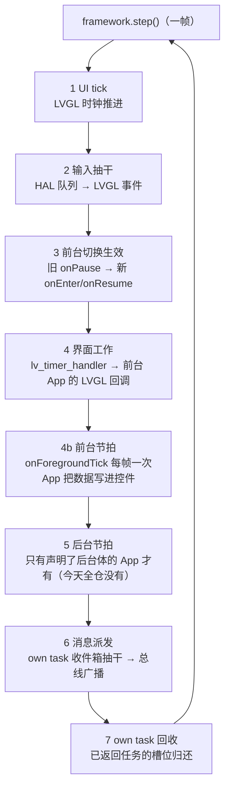
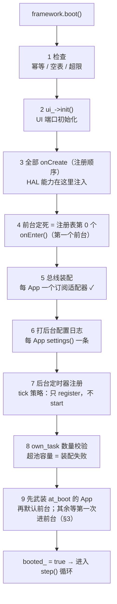
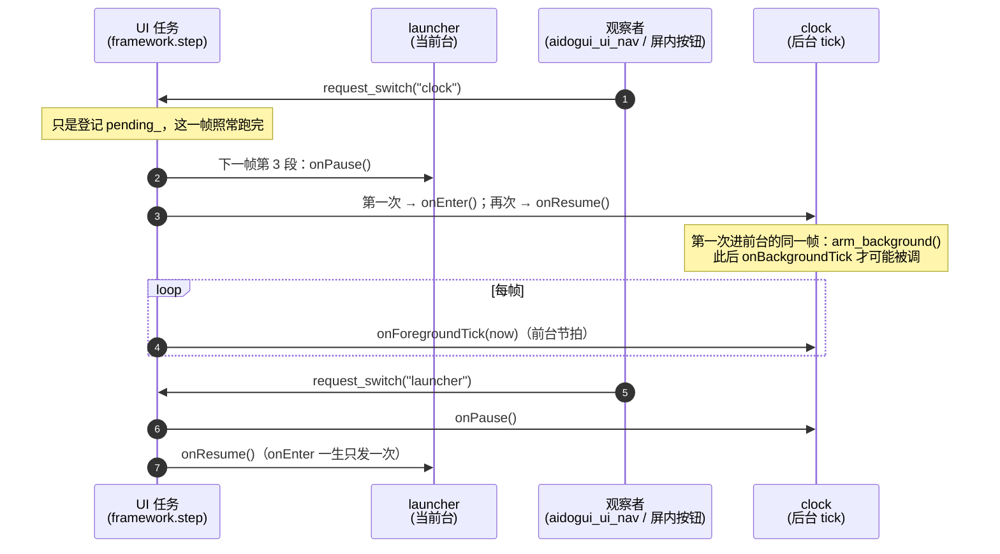
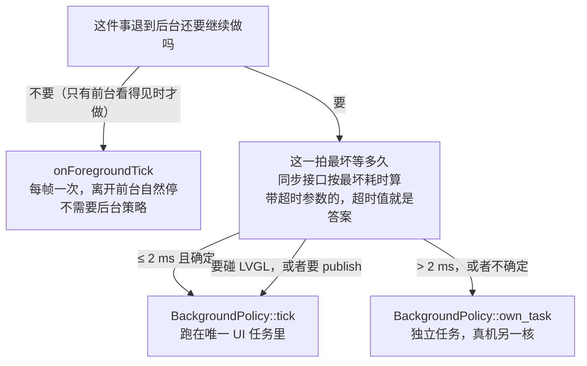
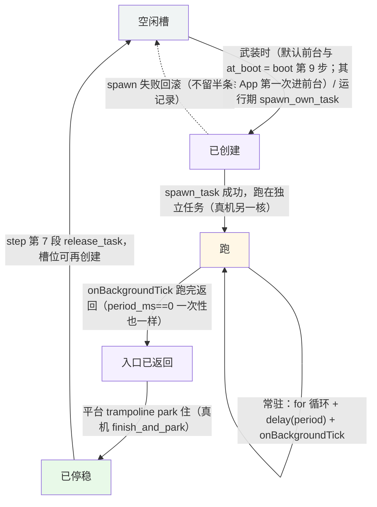
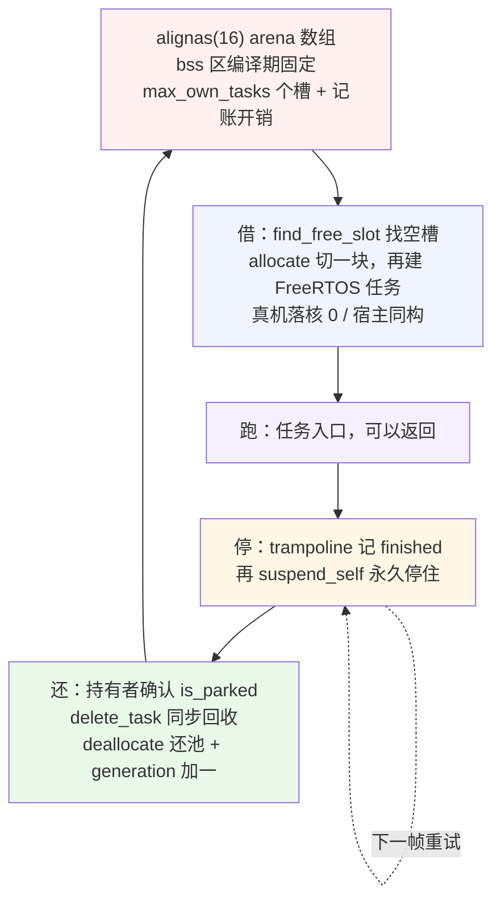

# Embark 运行时：切换、后台、own task 与消息

> 本文件用图讲清楚框架**是怎么跑起来的**：boot 装配顺序、唯一 UI 任务里的每一拍
> 做什么、前台切换在哪一刻生效、三种后台策略各自挂在哪儿、own task 从创建到回收
> 的完整生命周期。看懂这些，写任何 App 都不会在「什么时候被调、在哪条线程上跑、
> 能不能 publish」上犯迷糊。
>
> 「怎么用」（示例代码与判据）也收在本文：§4.4 申请后台、§5.8 own_task 写法、§6 消息；
> 契约原文见 [app.h](../../include/embark/app.h)、[framework.h](../../include/embark/framework.h)、
> [task_spawner.h](../../include/embark/task_spawner.h)；
> 决策背景见 [adr/0001](../adr/0001-single-ui-task-logic-apps.md)、[0004](../adr/0004-background-tick-and-state-policy.md)、[0005](../adr/0005-static-task-slots-and-pool.md)。

---

## 一句话核心

**全系统只有一条主线**：唯一 UI 任务在跑 `framework.step()`（宿主默认 5 ms 一拍，
真机按自己的循环周期重排），**一帧 = 7 段**。前后台切换、后台节拍、own task 的
消息与回收，全部挂在这一帧里；没有第二条驱动循环。装配则是 boot 一次做完的：
生命周期钩子、总线订阅、后台策略，全在进入循环前就位。

## 1. 一帧 step 的 7 段



| 段 | 做的事 | 谁的钩子被调 |
| --- | --- | --- |
| 1 | UI 时间轴（LVGL tick） | — |
| 2 | 输入事件处理（抽干 HAL 输入队列） | — |
| 3 | 边界切换 `apply_pending_switch` | 旧前台 `onPause`，新前台 `onEnter`/首个 `onResume` |
| 4 | 界面工作（`lv_timer_handler`） | 前台 App 的 LVGL 回调（事件） |
| 4b | 前台节拍 | 前台 App `onForegroundTick`（用它把数据写进控件） |
| 5 | 后台节拍 | 声明了 `tick` 的 App 的 `onBackgroundTick`（按各自周期）——**今天全仓没有这样的 App，这一段空转**（§4.3 / [ADR 0015](../adr/0015-app-retention-and-refresh.md)） |
| 6 | 消息派发 | 每个 App 的 `onMessage`（收件箱信封 + 同帧 publish 的消息） |
| 7 | own task 回收 | 入口已返回的任务 → 槽位归还（`reap_finished_own_tasks`） |

> **第 5 段今天什么都不做**：全仓没有 App 声明后台体——clock 与 launcher 的 `tick` 已在 2026-10-16 退役，改走第 4b 段的前台节拍（§4.3 与 [ADR 0015](../adr/0015-app-retention-and-refresh.md)）。

## 2. boot()：装配顺序（进入循环之前，一次做完）

`framework.boot()`（[framework.cpp](../../src/embark/framework.cpp) `:16-129`）按固定顺序
把三样东西装好：钩子（生命周期）、总线（消息）、后台（tick 定时器 + own task）。
注意后台是**两段式**：boot 只做「注册 / 校验」，真正**开跑在武装**（4.1）——例外是显式声明 `ArmPolicy::at_boot` 的 App：boot 第 9 步当场武装（4.2）。
**顺序本身就是契约**，每步之间谁先谁后都有原因：



| 步 | 做什么 | 为什么是这个顺序 |
| --- | --- | --- |
| 3 | 全部 `onCreate` | 按注册顺序；HAL 能力（`fw.hal()`）从这里注入 |
| 4 | 前台 = 注册表第 0 个，`onEnter` | 注册顺序即默认前台；第 0 个同时是主屏（ADR 0006） |
| 5 | 总线适配器逐个 `bind + subscribe` | **在 onCreate 之后**：onCreate 里 publish 的消息没人收（记 unknown WARN），装配消息请放 onEnter 之后 |
| 7 | tick 定时器**注册**（不启动） | 周期 = `ceil(period_ms / ui_loop_period_ms)` 个帧（`:87-89`）；宿主 5 ms 一拍，真机按自身循环周期重排。`start` 推迟到武装（4.1；`at_boot` 的 App 在第 9 步就 start）——但容量错误仍在装配期就暴露 |
| 8 | own_task 数量校验 | 声明 `own_task` 策略的 App 数 > `max_own_tasks` → 装配期就 `no_space`（**不进入循环**）；真正的创建推迟到武装（5.2）。声明 `at_boot` 的 own_task 也计入这个预检 |
| 9 | 武装后台策略（两轮） | 先按注册顺序武装所有声明 `ArmPolicy::at_boot` 的 App（4.2），再武装默认前台（注册表第 0 个在 boot 里已经 `onEnter`）；其余 App 等第一次被切进前台（§3）。**任一轮失败 = boot 失败**（不进循环） |

失败时 boot 直接返回具体 Error、**不进入循环**（此时任何 App 的 onExit 都不会被调）。

## 3. 前后台切换：请求只登记，帧边界生效

切换**绝不是请求瞬间发生的**：`request_switch` 只把目标写进 `pending_`，
真正执行在下一帧第 3 段。App 永远无权直接改前台，钩子顺序由框架定死。



钩子全集（[app.h](../../include/embark/app.h) `:95-119`）：

| 钩子 | 何时触发 | 次数 |
| --- | --- | --- |
| `onCreate` | boot 时，按注册顺序 | 一生一次 |
| `onEnter` | 第一次成为前台 | 一生一次（`entered_` 标志保证） |
| `onPause` | 离开前台 | 每次离开 |
| `onResume` | 再次成为前台 | 每次回来（onEnter 之后全是它） |
| `onForegroundTick` | 每帧第 4b 段，仅前台 App | 前台期间每帧一次 |
| `onBackgroundTick` | tick 策略按 period 触发（own_task 在自己的任务里循环） | **武装后**照跑：默认武装 = 第一次进前台，`at_boot` 的在 boot 第 9 步武装（4.2）；之后与前后台无关。**今天没有 App 声明后台体**，所以这个钩子今天一次都不会被调（§4.3） |
| `onMessage` | 总线广播（第 6 段） | 每个 App 都收 |
| `onExit` | 仅关机路径（`shutdown`） | 一生一次 |

## 4. 后台运行：三种策略，各挂一处

`BackgroundPolicy` 是每 App 一个的声明、`ArmPolicy` 是武装时机的声明（[app.h](../../include/embark/app.h) `:37-52`），
App 在 `settings()` 里自报家门；框架在 boot 第 7 步注册定时器、第 8 步校验 own_task 容量，
然后在这个 App **第一次进前台**时武装它（4.1）——除非它声明了 `ArmPolicy::at_boot`，那样
boot 第 9 步就武装（4.2）。**今天全仓没有一个 App 声明后台体**（clock 与 launcher 的 `tick` 已按 §4.3 退役），所以下面这张表读法上更像「将来想申请后台时怎么做」。

| 策略 | 谁在跑 | 挂在哪儿 | 注意 | 仓库例子 |
| --- | --- | --- | --- | --- |
| `suspend`（默认） | 谁也不跑 | — | 最省资源；只在被切到前台时有行为 | settings |
| `tick` | 唯一 UI 任务 | step 第 5 段（ETL callback_timer） | **必须轻量**：阻塞会卡住整个 LVGL 动画；武装之后才 `start`（`at_boot` 的在 boot 第 9 步 start） | 今天无人用（历史：clock 100 ms） |
| `own_task` | 独立 FreeRTOS 任务 | 自己的任务（栈深/优先级自配） | 发消息只能 `post()`，不能 `publish()`；完整生命周期见 §5 | 三个 App 都没声明；内核用例 `test_own_task_lifecycle.cpp` |

要点：

- **tick 的精度上限是帧粒度**：周期 = `ceil(period_ms / ui_loop_period_ms)` 个帧
  （framework.cpp `:87-89`）。宿主 5 ms 一拍。
- **后台一旦武装就与前后台无关**（这是本 ADR 定下的语义），但**今天没有 App 走这条路**：clock 曾在被切走后照样每 100 ms 跑（还每秒一条日志），2026-10-16 退役——「离开后不需要推进」的显示改走 4b 的前台节拍（§4.3）。
- 在默认（`on_first_enter`）下，**第一次进过前台之前这个节拍根本不会开始**——见 4.1；
  声明 `at_boot` 的不等前台，见 4.2。

### 4.1 默认武装时机：第一次进前台才开跑（issue 23 / ADR 0009）

> 一句话：**声明了后台策略 ≠ 一上电就在后台跑**。后台在 App「第一次进过前台」那一刻**武装**
> （内部 `arm_background`），武装一次即长期有效。


| 策略 | 武装这一下做什么 | 失败会怎样 |
| --- | --- | --- |
| `suspend` | 只把 `armed_` 记上（没有后台体） | 不可能失败 |
| `tick`（`period_ms > 0`） | `timers_.start(已注册的定时器)`，周期从此刻起算 | 定时器没注册 → `not_ready` |
| `tick`（`period_ms == 0`） | 视为没有后台体（等同 suspend） | 不可能失败 |
| `own_task` | `spawn_own_task_internal`：经 `ITaskSpawner` 建任务 | `no_space` / `busy` / `unsupported` |

- **默认前台（注册表第 0 个）**在 boot 里就进过前台，所以 boot 当场武装它（失败 = 装配失败、
  不进循环，与以前"own task 装不出来就不进循环"同口径）。
- **运行期武装失败不回滚切换**：前台已经切过去了，只是这个 App 没有后台；记 `ELOG_ERROR`
  + `arm_failures_`（观测 `framework.background_armed(id)` / `framework.arm_failures()`）。
- **武装 ≠ 只在前台之外跑**：武装之后，人在前台时后台也照跑。不是框架不想，而是 `own_task`
  在平台上是一个常驻任务（`for(;;){ delay(period); onBackgroundTick; }`），没有"暂停 / 恢复"
  这一说；框架能约束的只有**什么时候开始跑**。
- **RAM 位语义**：`entered_` 与 `armed_` 都是每次开机清零的内存位，准确说法是
  **"每次开机后被打开过一次才会跑后台"**。真机上"开机就该跑"的 App（闹钟）不再需要这种
  近似：在 `settings()` 里显式声明 `ArmPolicy::at_boot`（见 4.2，issue 24 / ADR 0010）。
- **两种武装时机互斥**：`on_first_enter`（默认）与 `at_boot` 二选一；`at_boot` 的 App 后来被
  切进前台也不会重复武装（`arm_background` 幂等、`armed_` 记账）。

### 4.2 显式 eager：`ArmPolicy::at_boot` 开机即武装（issue 24 / ADR 0010）

> 一句话：默认是"被打开过才跑"（4.1）；闹钟这类"由持久化状态驱动、不依赖用户点开"的 App
> 在 `settings()` 里加第 5 个字段，框架在 boot 第 9 步就把它的后台拉起来。

```cpp
AppSettings settings() const override {
  return AppSettings{BackgroundPolicy::own_task, 50U, 256U, 4U, ArmPolicy::at_boot};
}
```

| 声明 | boot 第 9 步 | 之后第一次进前台 | 典型 |
| --- | --- | --- | --- |
| `ArmPolicy::on_first_enter`（默认） | 只记账（不武装） | 同一帧武装 | 所有交互型 App（今天没有 App 声明后台体，这一行今天为空） |
| `ArmPolicy::at_boot` | 当场武装（`tick` → `start` 定时器，`own_task` → 建任务） | 不重复武装（`arm_background` 幂等） | 闹钟、上电即采样的服务型 App |

- boot 里 **at_boot 轮在前、默认前台轮在后**，两轮都按注册顺序；**任一轮失败 = 装配失败**
  （boot 返回具体 `Error`、不进循环），与"own task 装不出来就不进循环"同口径。
- `at_boot` 的 `own_task` 计入第 8 步的容量预检（超 `max_own_tasks` 仍是装配期 `no_space`）。
- 代价：这个 App 的前台可能还没加载过，它的后台已经在跑 —— 后台逻辑若依赖 UI 状态
  （控件、屏对象），要自己容忍（等第一次 `onEnter` / `onForegroundTick` 之后再做 UI 相关的事）。
- `at_boot` 只表达"什么时候开始跑"，不表达"跑起来不停"：`armed_` 仍是 RAM 位，每次开机
  重新按声明武装；App 自己的持久化状态（闹钟设了几点）用 `fw.hal().storage` 存。
- 决策背景与弃选方案：[ADR 0010](../adr/0010-arm-at-boot.md)。

### 4.3 谁该申请后台：三条轴、五类（2026-10-16 / [ADR 0015](../adr/0015-app-retention-and-refresh.md)）

「App 退出就结束」在今天**并不存在**：App 对象 boot 到关机常驻，`onExit` 只在关机路径调；离开一个 App 时结束的只有**它的屏**（切走即 destroy）与**后台跑不跑**。所以「要不要后台」其实是三条正交的轴，别搅成一件：

| 轴 | 问题 | 谁负责 |
| --- | --- | --- |
| 留存申请 | 离开之后还需要**往前推进**吗？ | 显式声明 `tick` / `own_task`（默认 `suspend`；**今天全仓无人声明**） |
| 视图留存 | 回来时需要**原样**吗？ | App 自持 view state（屏会被销毁重建） |
| 数据新鲜度 | 值什么时候**重算**？ | 第 4b 段的前台节拍 + 屏装载后重推 + 事件通知 |

五类 App 与各自的答案见 [ADR 0015](../adr/0015-app-retention-and-refresh.md)。三条落地要点：

- **前台渲染型不占后台**：clock（秒）与 launcher（主屏分钟、天气卡）由 `onForegroundTick` 驱动（只在前台跑，每帧一次、内部按秒/按分钟短路），进屏 / 回屏时重算。它们「离开后不需要推进」，也就没有后台体可申请。
- **视图状态 App 自己存**：屏每次装载都是新建的，控件值就是你拿到的设计稿初值。要留的东西存成成员变量：launcher 的磁贴页码（`onPause` 记 `launcher_tiles_current_page()`，重推时跳回）、clock 的月历视图月（`cal_view_y_` / `cal_view_m_` 在重推里不清）。
- **控件值重推挂到屏装载后**：`ui_backend_bind_repaint(屏名, fn)`（`onCreate` 声明一次）——桥的屏观察者第三次扩展，与点击绑定 / 逻辑动作绑定对称。不声明的话，屏重建后控件值会停在设计稿（launcher 时间停在 `11:31` 就是这么来的）。

### 4.4 怎么申请后台：一次声明 + 判据

> **今天全仓没有 App 声明后台体**（默认 `suspend`）：clock 与 launcher 已退役 `tick`，改走前台节拍
> （`onForegroundTick`）+ 屏装载后重推，见 [ADR 0015](../adr/0015-app-retention-and-refresh.md)。三种策略都还在，
> 但**后台是显式申请的例外** —— 本节读作「想申请时怎么做」。

声明就是 `settings()` 里那一行 —— 前 4 个字段必填，第 5 个（武装时机）有默认值：

```cpp
// tick：每 100 ms 一次（历史样板，2026-10-16 退役，见 ADR 0015）
AppSettings settings() const override {
  return AppSettings{BackgroundPolicy::tick, 100U, 0U, 0U};
}
// own_task：每 50 ms 一次，256 字栈（宿主 2 KB；真机按 stack_word_bytes 换算）
AppSettings settings() const override {
  return AppSettings{BackgroundPolicy::own_task, 50U, 256U, 4U};
}
```

占用的容量是编译期定死的（改在 `config/embark_limits.h`）：`max_apps`、`max_bus_subscribers`、
`max_background_timers`、`message_queue_depth`、`max_own_tasks`（同时在跑的 `own_task` 上限，
也是静态任务池的槽数）。

#### 能力矩阵：这条策略里能做什么

| 维度 | `suspend` | `tick` | `own_task` |
| --- | --- | --- | --- |
| 跑在哪条线程 | 不跑 | 唯一 UI 任务 | 自己的任务（真机钉核 0，UI 在核 1） |
| 能碰 LVGL 对象 | — | 能 | **绝对不能**（跨任务碰 LVGL 未定义） |
| 能 `publish()` | — | 能 | **不能**，只能 `post` 信封回 UI 再进总线 |
| 并发上限 | — | `max_background_timers` | `max_own_tasks`（默认 2） |
| `period_ms` 语义 | — | 周期；`0` 等价 `suspend` | `> 0` 常驻循环；`== 0` 跑一轮就结束、槽位回收 |
| 栈 | — | 借 UI 任务的（`ui_task_stack_words`） | 自己一份（默认 512 字，宿主 1 字 8 字节 = 4 KB） |
| 周期精度 | — | UI 帧粒度：`ceil(period_ms / ui_loop_period_ms)` | `vTaskDelay`，毫秒级 |
| 超限 / 失败 | — | 装配期定时器表满 → `no_space`；武装 `start` 失败记 `arm_failures()` | 装配期数量超限 → `no_space`（boot 直接失败）；运行期 `no_space` / `busy` / `unsupported` |

#### 判据：不是「这活重不重」，而是「这一拍最坏等多久」

微秒级的寄存器读写放哪都行；毫秒级的等 NMEA / 等网络 / 等 Flash 才是灾难。周期长短也不影响
线程归属 —— `period_ms` 是 `std::uint32_t` 毫秒，60000（1 分钟）完全合法：



**耗时速查**（400 kHz I2C 下 1 字节 ≈ 22.5 µs；拿不准就在 App 里量一次）：

| 这一拍要做的动作 | 最坏耗时 | 为什么 | 策略 |
| --- | --- | --- | --- |
| 累加计数、状态机、拼字符串 | 微秒 | 纯 CPU，不碰外设 | `tick` |
| 读一个 I2C 寄存器（1 写 + 1 读） | ≈ 50 µs | 两个字节 + 两次 START/STOP | `tick` |
| 写一个命令字节 | ≈ 25 µs | 一个字节 | `tick` |
| 读 IMU 六轴（12 字节） | ≈ 0.3 ms | 1 字节地址 + 12 字节数据 | `tick` |
| 读触摸一整包（27 字节） | ≈ 0.6 ms | 仓库现状就是每帧在 UI 任务里跑（`platform/esp32/src/esp32_input.cpp` 按 10 ms 节流） | `tick` |
| 大数组运算、图像缩放 | 几十 µs ~ 几 ms | 不阻塞但占 CPU，超过 2 ms 就会拖慢界面 | 超过 `tick` 的账就 `own_task` |
| 读一小段 Flash / 一个 NVS key | 数十 ms | 同步等 flash 操作 | `own_task` |
| 写 NVS / 擦一页 Flash | 几十 ~ 几百 ms | `nvs_set_blob` + `nvs_commit` 都要落盘 | `own_task`（或只在 `onPause` / `onExit` 写一次） |
| 等一句 NMEA（9600 baud 约 70 字节） | ≈ 73 ms | 1 字节 ≈ 1.04 ms | `own_task` |
| 等一次定位有效（GPS 冷启动） | 几百 ms ~ 秒级 | 不受你控制 | `own_task` |
| 网络请求 / MQTT 收发 | 几十 ms ~ 秒级，没有硬上限 | 断网时可能一直等 | `own_task` |
| 音频解码 + 写 I2S | 持续占用 | 要一直跑、不能被打断 | `own_task`，且 `period_ms > 0` |
| 总线故障路径（触摸 50 ms / `IBus` 100 ms 超时） | 到超时值 | 正常路径很短，但「不确定」本身就该按最坏值算 | 按最坏值判 |

**三个校准锚点**（别把 `tick` 的预算想得太宽）：

- UI 循环节拍 = **5 ms**（`config/embark_limits.h` 的 `ui_loop_period_ms`）：一个 `tick` 回调占掉 2 ms，
  这一帧就只剩 3 ms 给 LVGL、触摸和所有 App。
- 框架自己每帧最多花 **≈ 2.6 ms**（一次 flush 40 行 = 25.6 KB，80 MHz SPI，且同步等 DMA 结束，见
  `platform/esp32/src/esp32_display.cpp`）：框架已经用掉这个量级，App 别再往上叠同等量级。
- **触摸驱动就是「每帧在 UI 任务里碰 I2C」的活样本**（`platform/esp32/src/esp32_input.cpp`，10 ms 节流，
  注释写着「给 I2C 让路」）：所以「碰了 I2C 就必须 `own_task`」不成立；它的 50 ms 超时是**故障路径**，
  不是正常耗时。

**四个常见误判**：

- 「碰了 I2C / SPI 就必须 `own_task`」——不对：读寄存器、读 IMU 都是微秒~亚毫秒级，触摸驱动每帧就在
  UI 任务里跑。
- 「周期长 = 轻」——不对：1 分钟采一次 GPS，只要这一拍要等 NMEA，照样 `own_task`。
- 「`own_task` 里顺手把界面刷了」——不行：跨任务碰 LVGL 未定义，回 UI 只能 `post` 信封；所以「要刷界面」
  的活默认往 `tick` 靠。
- 「`own_task` 随便开」——只有 `max_own_tasks`（默认 2）个槽：GPS 收 + 音乐播放就占满了，第三个
  `own_task` App 会在装配期 `no_space`，让 boot 直接失败。稀缺资源要用在真正会等的地方。

> 一句话：**要刷界面或发广播 → `tick`；会等（毫秒级或不确定）→ `own_task`；只有前台才需要 →
> 连后台策略都不用声明。**

## 5. own task：从创建到回收的完整生命周期

own task 是"逃生舱"：tick 策略要求钩子轻量（在 UI 循环里跑），需要独立线程的重活
（阻塞 IO、长计算）就声明 `own_task`。它的生命周期跨框架（framework.cpp）与平台
（ITaskSpawner，真机 = platform/common/pooled_task_spawner.h）两站：



### 5.1 存储底座：own task 住进静态定容池（借一块 → 还回去）

own task 的内存**不是运行时堆**（仓库纪律：静态分配）。它由
`PooledTaskSpawner`（platform/common/pooled_task_spawner.h）管着一块
**编译期定容的静态池**：

- 池的 arena 是 `.bss` 里一块 `alignas(16) std::uint8_t[]`（:248），大小由
  `arena_bytes()` 编译期算死（:93-95）：`max_own_tasks` 个槽 × 每槽
  （登记项 + StaticTask_t + 静态栈）+ 每槽记账开销。
- 槽位状态机 `SlotState`（:52-56）：`free`（可再分配）→ `running`（任务已建、
  入口没返回）→ `finished`（入口已返回、park 着等持有者 release）。



借与还的完整路径（真机 / 宿主两边同构，只是「建 / 查停放 / 删」这三下不同）：

| 环节 | 做什么 | 证据 |
| --- | --- | --- |
| 借 | `find_free_slot()` 找空槽 → `pool_.allocate(slot_bytes)` 切一块（16 B 粒度）→ 先立 `running` 再建任务（真机落核 0） | pooled_task_spawner.h `:97-132` / esp32_task_spawner.h `:99-102` |
| 跑 | trampoline 先跑调用方入口；返回后 `mark_finished`，再 `suspend_self` **永久停住**（任务绝不自己消失） | pooled_task_spawner.h `:203-220` |
| 还 | 持有者 `release_task`：确认 `finished` + `is_parked` → `delete_task` 同步回收 → `deallocate` 整块还池（相邻块合并）→ `++generation` | pooled_task_spawner.h `:134-155` |

要点：

- **容量是编译期常量**：`max_own_tasks = 2`（同时最多 2 个 own task），每任务
  栈 `own_task_stack_words = 512`（约 4 KB）；池满 / 栈深超限 → `Error::no_space`
  （config/embark_limits.h `:65-72`）。
- **「还」有责任方**：任务入口返回 ≠ 槽位可复用——park 之后要等持有者
  （唯一 UI 任务）在 step 第 7 段 `release_task` 才真正还池；`finished()` 观测
  不为 0 就说明有槽占着没还。
- **复用安全**：`release` 时 `++generation`，旧句柄（TaskToken）从此稳定拿到
  `not_found`，绝不误杀复用槽位的新任务（详见 5.5）。

### 5.2 创建（framework.cpp `:275-311`，武装路径与运行期同一条路）

`spawn_own_task_internal` 的检查顺序就是失败口径表：

| 情况 | 返回 |
| --- | --- |
| 编号无效 | `not_found` |
| boot 前 / shutdown 后 | `not_ready` |
| 平台没给 spawner，或该 App 不是 own_task 策略 | `unsupported` |
| 池满 / 栈深超过槽容量 | `no_space` |
| 同一个 App 已有任务在跑 | `busy`（同一 App 同时只允许一个任务） |
| 栈深 `task_stack_words == 0` | 取配置默认 `own_task_stack_words` |

另有一条**装配期**的确定失败点（issue 23）：boot 第 8 步先数一遍声明 `own_task` 的 App，
超过 `max_own_tasks` 就直接 `no_space`、不进循环——容量配错不会拖到运行期才炸。

细节：任务参数（fw 指针 + App 编号）必须在 `spawn_task` 之前写进记录
（真机上任务建好就可能开跑）；spawn 失败会把记录回滚成空闲，**不留半条记录**。

### 5.3 跑（framework.cpp：入口 `own_task_entry` `:241-249` → `run_own_task` `:251-266`）

- `period_ms == 0`：**一次性任务** —— `onBackgroundTick` 跑一轮即返回。
- 否则：`for(;;){ delay_ms(period); onBackgroundTick; }` —— 常驻循环。
- **入口允许返回**：返回 = 任务自行结束，不是错误（issue 15 起）。这是它和
  普通裸机任务最大的区别——结束得优雅，不收致命。

### 5.4 停稳与回收（平台一半 + step 第 7 段）

- **停稳**：入口返回后，平台池的 trampoline 把任务 park 在槽里
  （真机 pooled_task_spawner 的 `finish_and_park`），等持有者来收。
- **回收是持有者（唯一 UI 任务）的事**（task_spawner.h `:10-14`）：只有它知道任务
  跑完没、什么时候该把槽位还给池。任务自己回收自己会踩 FreeRTOS 的"删除中"
  中间态（TCB 还在终止链表上，复用静态存储会写出致命的别名）。
- step 第 7 段 `reap_finished_own_tasks`（framework.cpp `:313-332`）逐个 `release_task`：
  - 还在跑 → `busy`（**不是错误**，下一帧再试）；
  - 已停稳 → 成功，槽位清零、`++own_tasks_released_`；
  - 成功后该槽位立即可被下一次 spawn 复用。

### 5.5 句柄保护：TaskToken 的世代号（task_spawner.h `:29-37`）

任务句柄 = `{ slot, generation }`：槽位被回收时 `++generation`，于是
**释放一个已经释放过的句柄**稳定地拿到 `not_found`，而不会误杀刚刚复用这个
槽位的新任务；重复释放同一个句柄是安全的（第二次必然 not_found）。

### 5.6 关机路径

`shutdown` **不做 own task 终止**（framework.cpp `:382-404`）：入口已返回的任务
槽位由 step 回收段归还；仍在跑的任务只随进程退出（宿主由 `exit_process(_Exit)` 兜底）。

### 5.7 契约测试（比文档更权威）

`tests/kernel/test_own_task_lifecycle.cpp` 四个用例：① 创建 → 跑完 → 回收 →
再创建（跟着日志读，`:252`）；② 两个 App 各自在**武装时**创建、池满 `no_space`、
失败不留记录（`:338`）；③ 常驻任务永远不被回收（回收只认「入口已返回」，`:397`）；
④ `ArmPolicy::at_boot` 的 App 开机即武装、不等前台（`:425`）。平台池那一半（定容、
世代号）由 `tests/kernel/test_pooled_task_spawner.cpp` 六个用例逐格验证。

### 5.8 怎么用：常驻 / 一次性 / 运行期再创建

```cpp
// 常驻写法：period_ms > 0，框架按周期反复调 onBackgroundTick
AppSettings settings() const override {
  return AppSettings{BackgroundPolicy::own_task, 50U, 256U, 4U};
}

// 一次性写法：period_ms = 0，框架只调一轮 onBackgroundTick，返回后任务就结束
AppSettings settings() const override {
  return AppSettings{BackgroundPolicy::own_task, 0U, 256U, 4U};
}

// 运行期再创建一次：只能在 UI 任务里、boot 之后 shutdown 之前调用
const embark::Error err = fw.spawn_own_task(fw.id_of(*this));
// none / not_found / not_ready / unsupported / no_space / busy
```

三条纪律：

- **回收只能由持有者做**：持有者就是唯一 UI 任务（它也是唯一调 `spawn_task` 的人）。任务自己删
  自己会走 FreeRTOS 的「删除中」分支（静态 TCB 要等空闲任务才真正释放），此时复用存储会写出
  致命别名。`ITaskSpawner::release_task` 只给持有者用，任务内部不要碰。
- **池满就是 `no_space`**，不排队、不降级：同时在跑的 `own_task` 上限 = `max_own_tasks`（静态池的
  槽数），超了直接拒绝创建。失败点唯一且确定是刻意的，见
  [adr/0005](../adr/0005-static-task-slots-and-pool.md)。
- **别在自己的任务里等结果**：要等外部事件（WiFi 连接、超时）就阻塞在自己的任务里，成功或超时后
  `return`，槽位自然回收 —— UI 全程不被阻塞。这正是「运行期创建、完成即回收」的第一个真实用例。

观测：`fw.own_tasks_spawned()` / `fw.own_tasks_released()` 是累计创建/回收计数；任务池自身的
`running() / finished() / free_slots()` 在 `platform/common/pooled_task_spawner.h` 上。系统用例见
`tests/kernel/test_own_task_lifecycle.cpp`。

## 6. 消息投递：publish 与 post 两条路

| | `publish` | `post` |
| --- | --- | --- |
| 谁调 | 框架线程（UI 任务 / tick / 生命周期钩子） | own task |
| 路径 | 直接总线广播 → 每 App `onMessage` | 信封入收件箱（锁在队列内）→ UI 第 6 段抽干后广播 |
| 阻塞风险 | 无（同步广播） | 无（绝不阻塞 UI；信封攒着等 UI 消化） |
| 纪律 | **own task 里不能 publish** | 跨任务汇报结果的唯一正道 |

收件箱累计溢出次数可在 `framework.inbox_overflows()` 观测（own task 发太快、
UI 来不及消化的信号）。契约见 framework.h `:31-34`。

### 6.1 消息类型怎么定义

派生 `embark::MessageT<ID>`，ID 是消息型在进程内的唯一身份：

```cpp
#include <embark/message.h>

// 有基类就不是聚合了，必须显式构造（这和 struct 直觉不同，见 [pitfalls](../reference/pitfalls.md)）
struct BrightnessMessage : public embark::MessageT<0x21> {
  constexpr BrightnessMessage(std::uint8_t level_value = 0) noexcept : level(level_value) {}
  std::uint8_t level = 0;  // 0..3 四档
};
```

ID 分配：`0xFE` 是框架保留的跨任务信封（`CrossTaskMessage`），**不要用**；demo 用 `0x21`；自己的 App
挑不冲突的值即可，并写进注释。判断消息身份在接收端：`msg.get_message_id() == BrightnessMessage::ID`
（`MessageT` = `etl::message<Id>`，自带静态 `ID` 与实例 `get_message_id()`）。

### 6.2 怎么收：不用自己订阅，框架已挂好适配器

App 端**不需要显式订阅**：框架装配阶段给每个 App 挂了一个常驻适配器，所有广播都会被投递到每个 App
的 `onMessage(const Message&)`；收方自己按 ID 挑：

```cpp
void MyApp::onMessage(const Message& msg) override {
  if (msg.get_message_id() == BrightnessMessage::ID) {
    const auto& b = static_cast<const BrightnessMessage&>(msg);  // ID 匹配后安全
    level_ = b.level;   // 更新自己的副本
  }
}
```

### 6.3 怎么发：同任务 `publish`，跨任务 `post`

```cpp
// 同任务内：直接广播（无人订阅会计数 + WARN，不会 blocking）
fw.publish(BrightnessMessage{new_level});
```

`own_task` App 不能用 `publish`（跨线程！），只能 `post` 信封、回 UI 再进总线：

```cpp
// MyOwnTaskApp::onBackgroundTick（运行在自己的任务里）
fw.post(embark::CrossTaskMessage(id_of(*this), ++seq_));
// 信封回到 UI 任务后按序派发给自己，onMessage 里按 seq 对账
```

`onCreate(Framework& fw)` 里保存 `fw_ = &fw;` 之后用。

### 6.4 状态机怎么和消息接上

消息只改一个「值」时，直接存成员就够了（`app/clock/` 收 `BrightnessMessage` 就是这样）。要
「**收消息即切状态**」就用 `etl::fsm`：状态机是 App 的成员，`onMessage` 里转投一行（框架的 `Bus`
只以 `const&` 暴露，App 不能自己 subscribe）：

```cpp
class LampApp final : public embark::App {
  void onCreate(Framework& fw) override { (void)fw; fsm_.start(); }     // 初始状态 = id 0
  void onMessage(const Message& msg) override { fsm_.receive(msg); }    // 不认识的 id 走 on_event_unknown
  void onBackgroundTick(std::uint32_t) override { fsm_.receive(TickMessage{}); }

 private:
  LampFsm fsm_;  // 继承 etl::fsm，同时是 etl::imessage_router
};
```

完整例子、运行语义（`start()` 的链式跳转、`on_exit`/`on_enter` 顺序、`Self_Transition`）与常见坑见
[guides/state-machine-and-messages.md](../guides/state-machine-and-messages.md)。

## 7. 演示对照

`app/launcher/`（主屏 + 导航接线 + 视图留存 + 值重推）、`app/clock/`（前台节拍推进显示 + 月历视图留存 +
收 `BrightnessMessage`）、`app/settings/`（suspend + `publish` 亮度消息 + 屏内回调 + 设置项落 KV，
见 [ADR 0018](../adr/0018-settings-truth-and-growth.md)）是最完整的范本；`app/common/app_messages.h`
定义了 `BrightnessMessage`。**今天这三个 App 都不声明后台策略**（全仓也没有别的 App 声明）：`tick` 的
历史样板是 clock 的 100 ms，已按 [ADR 0015](../adr/0015-app-retention-and-refresh.md) 退役；`own_task` 的
完整系统用例在 `tests/kernel/test_own_task_lifecycle.cpp`（宿主演示 `ui_demo` 仍按这 3 个 App 注册）。

## 8. 关键源码索引

| 主题 | 位置 |
| --- | --- |
| 一帧 7 段 | `src/embark/framework.cpp:131-166` |
| boot 装配顺序（onCreate → onEnter → 总线 → 注册 tick 定时器 → own_task 数量校验 → 先武装 at_boot、再武装默认前台） | `src/embark/framework.cpp:16-129` |
| 边界切换（onPause → onEnter/onResume → 武装） | `src/embark/framework.cpp:352-380` |
| 切换请求只登记 pending | `src/embark/framework.cpp:168-182` |
| **后台武装**（幂等；tick → start 定时器，own_task → spawn） | `src/embark/framework.cpp:200-239` |
| 运行期创建 own task（spawn_own_task） | `src/embark/framework.cpp:268-273` |
| own task 创建细节与失败口径（spawn_own_task_internal） | `src/embark/framework.cpp:275-311` |
| own task 入口与常驻/一次性循环 | `src/embark/framework.cpp:241-266` |
| own task 槽位回收 | `src/embark/framework.cpp:313-332` |
| 关机路径（前台 onPause + 各 App onExit，own task 不终止） | `src/embark/framework.cpp:382-404` |
| 后台策略 / 武装时机枚举 + AppSettings | `include/embark/app.h:37-61` |
| App 钩子契约 | `include/embark/app.h:95-119` |
| step/own task/publish/post 纪律 + 武装时机语义（文件头注释） | `include/embark/framework.h:1-66` |
| 后台武装的观测接口（`background_armed` / `arm_failures`） | `include/embark/framework.h:156-167` |
| 后台记账位（`entered_` / `armed_` / `bg_timer_ids_`） | `include/embark/framework.h:298-305` |
| 运行期武装失败计数 `arm_failures_` | `include/embark/framework.h:326-327` |
| 任务句柄（slot + 世代号）与 spawn/release 语义 | `include/embark/task_spawner.h:29-67` |
| 任务池：借（allocate）与还（deallocate）+ 槽位状态机 | `platform/common/pooled_task_spawner.h:97-155` |
| own task 容量常量（max_own_tasks=2、栈 512 字） | `config/embark_limits.h:65-72` |
| UI 端口契约（tick/pump_input/process） | `include/embark/ui_port.h` |
| **控件值重推**（屏装载后 → App 的 repaint；容量 8 条） | `app/common/aidogui_ui_nav.cpp:77-110`（观察者里调）、声明入口 `app/common/ui_backend.h:61` |
| App 的**视图留存**样板（磁贴页码 / 月历视图月） | `app/launcher/launcher_app.cpp`（`onPause` 记页码）、`app/clock/clock_app.cpp`（`repaint_screen()` 不清 `cal_view_*`） |
| 前台渲染型刷新的驱动点（`onForegroundTick` → 写控件） | `app/clock/clock_app.cpp`、`app/launcher/launcher_app.cpp` |

## 9. 想再深入

- **怎么用**（示例代码 + 判据）：本文 §4.4（申请后台）、§5.8（own_task 三写法与三条纪律）、§6（消息）
- **架构决策**：[adr/0001](../adr/0001-single-ui-task-logic-apps.md)（单一 UI 任务）、
  [0004](../adr/0004-background-tick-and-state-policy.md)（后台节拍与状态范式）、
  [0005](../adr/0005-static-task-slots-and-pool.md)（静态槽位与任务池）、
  [0009](../adr/0009-background-arm-on-first-enter.md)（后台武装时机：第一次进前台才开跑）、
  [0010](../adr/0010-arm-at-boot.md)（显式武装时机：`at_boot` 开机即武装）、
  [0015](../adr/0015-app-retention-and-refresh.md)（留存与刷新：三条轴、五类 App、值重推挂到屏装载后）
- **比文档更权威的契约测试**：`tests/kernel/test_own_task_lifecycle.cpp` 与
  `tests/kernel/test_pooled_task_spawner.cpp`（own task 全链路）、`tests/kernel/test_framework.cpp`
  （切换/节拍/消息的正确用法）。